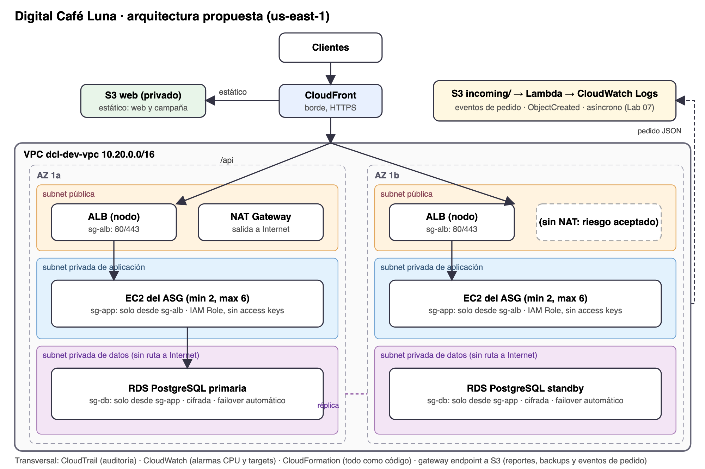
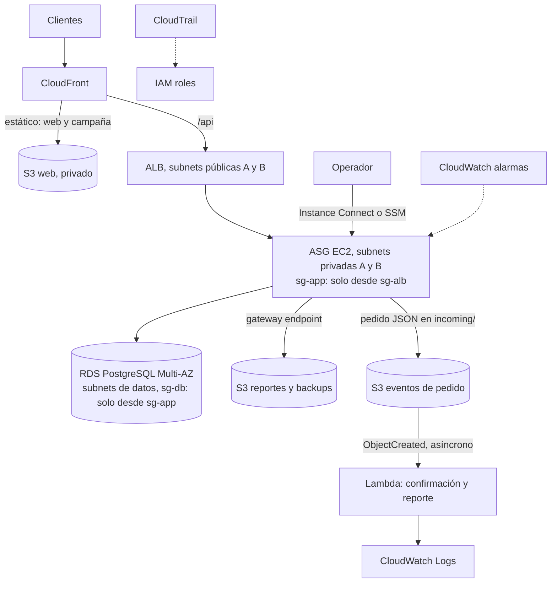

# Architecture Decision Brief: Digital Café Luna

Sergio Alfredo Junca Valero · ST1611 Computación en Nube · EAFIT · Entrega antes del 28 oct 2026, 6:00 p. m.

## 1. Problema y restricciones

Digital Café Luna prepara una campaña nacional de pocos días. La demanda es irregular y no se conoce su pico. La plataforma debe guardar clientes y pedidos, seguir funcionando si cae una zona y operarse con un equipo pequeño y presupuesto limitado.

| Restricción | Prioridad | Consecuencia de diseño |
|---|---|---|
| Demanda variable e incierta | Alta | Capacidad elástica y contenido estático fuera del cómputo |
| Datos de clientes y pedidos | Alta | Estado en un servicio administrado, privado, cifrado y con backup |
| Resiliencia | Alta | Dos Availability Zones; reemplazo automático de instancias |
| Equipo pequeño | Alta | Servicios administrados y todo definido como código; sin plataforma propia que mantener |
| Costo controlado | Alta | Pagar por uso, techo explícito de capacidad, nada duplicado sin razón |
| Capacidad de evolución | Media | Decisiones reversibles; lo avanzado queda como siguiente etapa |

## 2. Arquitectura propuesta

Versión editable del mismo diagrama:

Red: VPC `10.20.0.0/16` (la del Lab 01, con una subnet por AZ en 1a y 1b), tres capas en dos AZ. Solo CloudFront y el ALB son alcanzables desde Internet. La app y la base de datos no tienen IP pública.

## 3. Decisiones principales

1. **Web y campaña en S3 + CloudFront.** La campaña es el pico más probable y es contenido estático: se sirve desde el borde y no consume cómputo. Sacrifica poco; el riesgo es invalidar caché al publicar.
2. **Cómputo en EC2 con Auto Scaling Group (mínimo 2, máximo 6) detrás de ALB.** Lo vimos funcionar en el Lab 02: el ALB retira tráfico del target unhealthy y el ASG restaura la capacidad deseada. El techo máximo es el control de costo. No se escala con una policy hasta medir la demanda real (target tracking sobre CPU como primer paso).
3. **Pedidos y clientes en RDS PostgreSQL Multi-AZ.** Son datos transaccionales y relacionales; el equipo conoce SQL. Multi-AZ da failover automático con RPO casi cero dentro de la región. Sacrifica costo (instancia standby) frente a Single-AZ.
4. **Seguridad por capas.** Security group por capa que referencia al SG anterior (ALB, app, base de datos). IAM Role en las EC2, sin access keys (Lab 05). Policy mínima por Action y Resource. SSE en S3 y RDS. CloudTrail para atribuir cambios.
5. **Salida a Internet y servicios AWS.** S3 por gateway endpoint (gratis). Un solo NAT Gateway para actualizaciones y APIs externas.
6. **Operación como código.** Infraestructura en CloudFormation; alarmas de CloudWatch sobre CPU del ASG y salud de targets. El mismo template crea, actualiza y borra el stack.
7. **Modernización parcial: tareas posteriores al pedido por evento.** Cuando la app confirma un pedido, deja un JSON en `incoming/` de un bucket privado. S3 emite `ObjectCreated` e invoca una Lambda de forma asíncrona, que envía la confirmación, alimenta el reporte y escribe una línea JSON en CloudWatch Logs (Lab 07). Así el pico de la campaña no carga a las EC2 con trabajo que no necesita respuesta inmediata, y el equipo no administra servidores para esa parte. Sacrifica: la entrega es asíncrona y al menos una vez, así que la Lambda debe ser idempotente (el key del objeto es el identificador del pedido).
8. **Qué NO se moderniza ahora.** Contenedores, serverless para el núcleo transaccional de pedidos y base NoSQL. Aportan elasticidad pero exigen competencias nuevas y rediseñar el modelo de datos; con equipo pequeño el riesgo supera el beneficio antes de la campaña.

## 4. Trade-offs, riesgos y supuestos

| Decisión | Gana | Sacrifica | Riesgo que conserva |
|---|---|---|---|
| ASG con máximo 6 | Costo acotado | Techo de capacidad | Un pico mayor degrada el servicio |
| Un solo NAT | Menos costo fijo | Resiliencia de la salida | Si cae su AZ, la app pierde salida a Internet (no a S3 ni a la base) |
| RDS Multi-AZ | Failover automático | Costo de standby | Sin réplica en otra región: una falla regional implica restaurar |
| Backup and restore entre regiones | Barato | RTO de horas | Pérdida de servicio prolongada ante falla regional |
| EC2 en vez de serverless para el núcleo | Simplicidad conocida | Elasticidad fina | Capacidad ociosa fuera de campaña |
| Lambda por evento para tareas posteriores | Desacopla el pico; sin servidores que operar | Respuesta inmediata y orden de eventos | Evento duplicado o fallido: idempotencia y alarma sobre `Errors` de la función |

Supuestos: la campaña dura pocos días; el pico es de un orden de magnitud sobre la carga normal (a validar con prueba de carga); RPO aceptable de 5 minutos y RTO de 1 hora ante falla de zona, 4 horas ante falla regional; la aplicación es stateless en la capa EC2 (sesiones y archivos fuera de la instancia).

## 5. Costo (aproximación mensual, us-east-1)

Precios de lista on-demand de us-east-1 consultados en la AWS Price List API (la misma fuente de la Pricing Calculator) el 21 oct 2026 (Lambda el 23 oct); 730 horas por mes. Los consumos (GB, LCU) son supuestos.

| Componente | Precio de lista | Estimado USD/mes |
|---|---|---|
| ALB | USD 0,0225/h + USD 0,008 por LCU-h (1 a 5 LCU) | 22 a 30 |
| 2 EC2 t3.small (base) + 2 volúmenes de 8 GB | USD 0,0208/h cada una | 31 |
| NAT Gateway | USD 0,045/h + USD 0,045/GB (50 a 150 GB) | 35 a 40 |
| RDS PostgreSQL Multi-AZ, db.t4g.small + 20 GB gp2 | USD 0,065/h + USD 0,23/GB-mes | 52 |
| CloudFront + S3 | GB transferidos y requests (no consultado; sube con la campaña) | 5 a 20 |
| Lambda + CloudWatch Logs (eventos de pedido) | USD 0,20 por millón de requests + USD 0,0000166667 por GB-s; 100.000 pedidos de 128 MB y 0,3 s | menos de 1 |
| IPv4 públicas (2 del ALB + 1 del NAT, USD 0,005/h cada una), alarmas CloudWatch | Por recurso | 12 a 15 |
| **Total base** | | **155 a 190** |

Cost drivers dominantes: NAT, RDS Multi-AZ y horas de cómputo. Palancas: apagar el entorno de desarrollo fuera de horario, usar Savings Plans solo cuando la demanda base sea estable, y retirar el NAT si la app solo necesita S3 (endpoint) y servicios con VPC endpoint.

Después de la campaña se puede bajar el ASG a mínimo 1 y RDS a Single-AZ solo en entornos no productivos.

## 6. Evolución

- **Ahora:** lo descrito arriba, con Lambda solo para tareas posteriores al pedido.
- **Siguiente:** ElastiCache para catálogo, Secrets Manager para credenciales de la base, WAF delante de CloudFront.
- **Después:** contenedores (ECS Fargate) y réplica de lectura o DR warm standby en otra región si el negocio justifica un RTO menor.

## 7. Evidencia técnica propia: Labs 01 a 07

Las afirmaciones del brief se apoyan en los siete labs evolutivos corridos en mi cuenta, con cleanup verificado (resultados en la app <https://sjunka.github.io/ComputacionEnNube/>):

| Lab | Qué comprobé | Decisión que sustenta |
|---|---|---|
| 01 · Red base | VPC `dcl-dev-vpc` 10.20.0.0/16, subnets 10.20.1.0/24 en 1a y 10.20.2.0/24 en 1b. Dos AZ preparan la alta disponibilidad, pero no la dan sin cómputo repartido y reemplazo | Red de la sección 2 |
| 02 · Resiliencia | Distribución 10/10 entre dos AZ por el ALB; instancia terminada, retirada del target group y reemplazada por el ASG | 2 |
| 03 · Almacenamiento | S3 guarda versiones de un objeto; EFS da el mismo sistema de archivos a dos instancias en AZ distintas. Object, block y file no son intercambiables | Estado fuera de la instancia (supuestos), 3 y backups en S3 |
| 04 · Networking | Subnet pública solo por su route table; PASS, FAIL (timeout) y PASS de A a B quitando y restaurando una regla del SG | 4 (SG por capa) y validación 4 |
| 05 · Seguridad | Mismo role, misma red: GetObject PASS en `allowed/*`, AccessDenied en otro Resource y en PutObject; SSE-S3; AttachRolePolicy visible en CloudTrail | 4 |
| 06 · Operación | Stack de CloudFormation (EC2, SG y alarma) en CREATE_COMPLETE en 26 s; alarma de CPU (Average ≥ 70, 2 de 2 periodos de 5 min) OK, ALARM con CPU 75, 100, 100% y OK al terminar; update v1 a v2 sin reemplazo; Delete stack sin residuos | 6 |
| 07 · Modernización | `incoming/order-001.json` produce `ObjectCreated:Put`, una invocación y una línea JSON en CloudWatch Logs con el mismo key y requestId. Sin permiso de invocación, S3 rechaza la notificación. Control negativo: `.txt` y `archive/` no invocan | 7 |

## 8. Cómo validaría el comportamiento (para la defensa)

1. Prueba de carga hasta el pico supuesto; ver que el ASG agregue instancias sin superar el máximo y que la latencia se mantenga.
2. Terminar una instancia de la app; el ALB deja de enviarle tráfico y el ASG vuelve a la capacidad deseada.
3. Forzar failover de RDS; medir tiempo hasta que la app vuelve a escribir (RTO) y confirmar que no hay pedidos perdidos (RPO).
4. Intentar llegar a la base desde Internet y desde un SG ajeno: debe fallar por timeout.
5. Revisar CloudTrail para atribuir un cambio de IAM o de SG.
6. Subir un pedido de prueba a `incoming/` y seguir la cadena objeto, evento, invocación y log con el mismo key; repetir el mismo key y confirmar que la Lambda no duplica la confirmación.
