Sergio Alfredo Junca Valero · ST1611 Computación en Nube. Sustento con este tablero: <https://sjunka.github.io/digital-cafe-luna/?escena=problema&paso=1>

## Lo que pide el profe

"El Brief muestra qué decidiste. La defensa demuestra que entiendes por qué lo decidiste." (correo del 26 de octubre)

Para cada decisión debo poder decir 6 cosas:

1. Qué decidí.
2. Qué restricción lo justificó.
3. Qué problema resuelve.
4. Qué sacrifico: el trade-off.
5. Qué riesgo permanece.
6. Cómo demostraría que funciona.

**La cadena:** restricción → decisión → mecanismo → consecuencia → trade-off. La guía agrega evidencia y alternativa.

**Rúbrica de la defensa (20 puntos):** dominio de las decisiones 5, razonamiento técnico 5, trade-offs, riesgos y adaptación 6, validación y evidencia 4.

**No respondo:** "Usé Auto Scaling porque mejora la escalabilidad." "Porque hoy todo es Kubernetes." "Por portabilidad", sin decir qué restricción lo pide.

**Sí respondo (ejemplo del correo):** "La demanda es variable, así que no conviene mantener capacidad fija para el pico. Por eso uso capacidad que escala, y la infraestructura se ajusta a la demanda. Reduzco la capacidad ociosa, pero tengo que vigilar cómo escala."

**Lo que dijo en la clase del 28 de octubre:**

- Pide cifras: "lo hizo, lo probó". Qué decidí, por qué, qué valor entregó y cuánto costó.
- No evalúa el servicio elegido. Evalúa la justificación.
- Buena respuesta suya: "dos instancias en dos AZ, sin multirregión aunque sé que se puede".
- Puede preguntar por cualquier pieza del diagrama. Lo que nombro tiene que estar en el diagrama.
- Me llama con cámara abierta y todos escuchan.

**Si no sé algo:** "No lo medí. Lo que sé es \_\_\_, y lo comprobaría con \_\_\_."

## Cómo manejar el tablero

1. En Chrome abro el enlace de arriba, con `?escena=problema&paso=1`. Así abre quieto en el paso 1.
2. Comparto la ventana de Chrome en Teams y pulso `F` para pantalla completa y `T` para el reloj.
3. Avanzo **solo con `→`**. Pasa de un paso al siguiente y de una escena a la otra.
4. Antes de la lámina 42 pulso `Esc` para salir de pantalla completa y bajo con la rueda.

**Cuidado:** las teclas `1` a `7` y abrir el sitio sin el enlace hacen que la escena corra sola mientras hablo. Si pasa, `Espacio` la detiene. Para una pregunta sí uso `1` a `7`, y enseguida `Espacio`.

Las demos de `/demos/` son para estudiar. No las abro mientras comparto.

## Parte 1: los 10 minutos

Texto en gris: lo salto si voy tarde. Tiempos a 150 palabras por minuto, sin pausas.

### 01 · El problema · paso 1 de 6

**Tiempo:** 20 s (23 s con lo opcional)

**Clic:** ya está abierto · caso

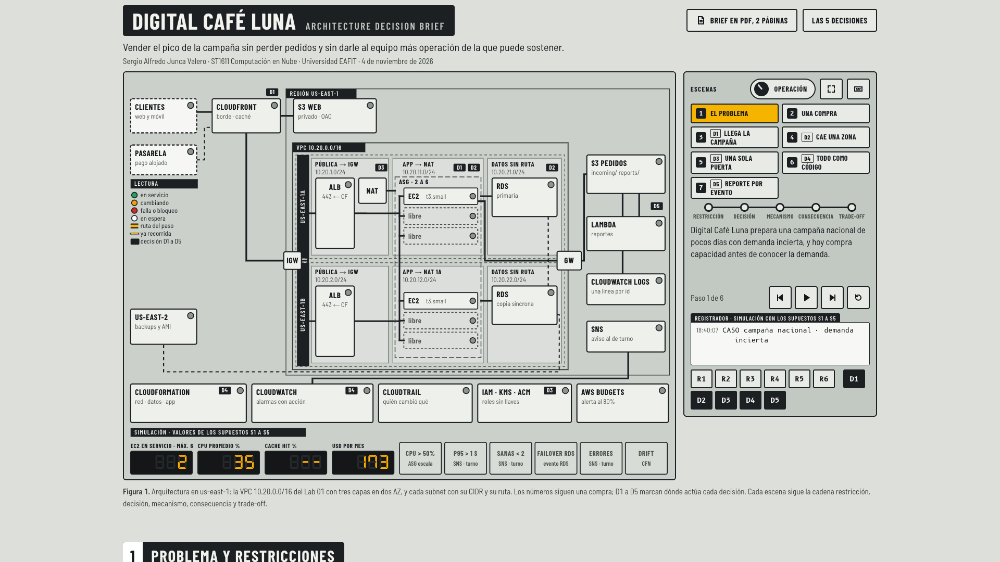

Buenas noches, profe. Le presento mi Brief de Digital Café Luna. Esta es la figura 1 del Brief, animada. Los medidores son una simulación con mis supuestos, no medidas reales.

Café Luna va a lanzar una campaña nacional de pocos días y no sabe cuánta gente va a llegar. [Hoy compra capacidad antes de conocer la demanda.]{.opc}

### 02 · El problema · paso 2 de 6

**Tiempo:** 6 s

**Clic:** `→` · R1

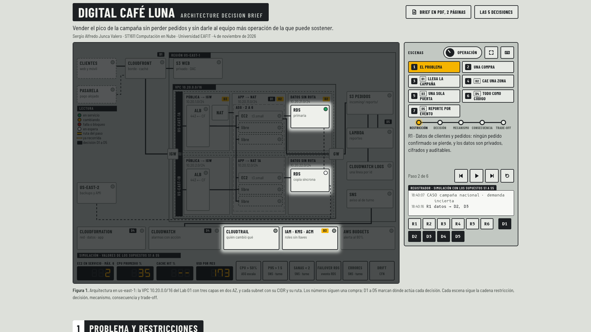

Seis condiciones cambian la arquitectura. Primera: no puedo perder pedidos ni exponer datos de clientes.

### 03 · El problema · paso 3 de 6

**Tiempo:** 2 s

**Clic:** `→` · R2

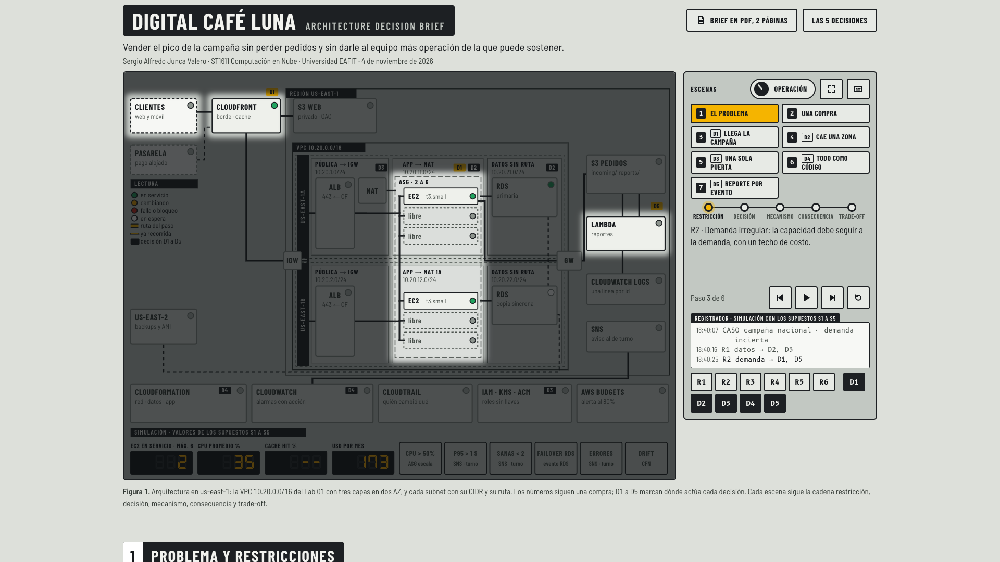

Segunda: la demanda sube y baja.

### 04 · El problema · paso 4 de 6

**Tiempo:** 2 s

**Clic:** `→` · R3

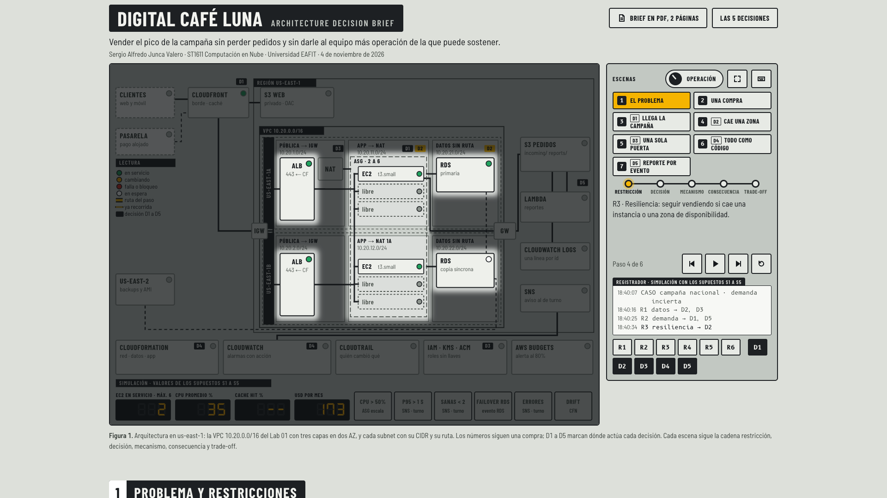

Tercera: seguir vendiendo si algo falla.

### 05 · El problema · paso 5 de 6

**Tiempo:** 3 s

**Clic:** `→` · R4 y R5

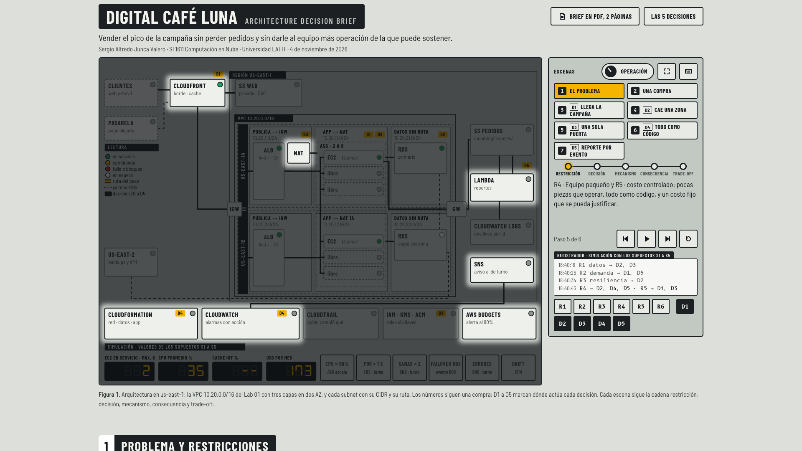

Cuarta y quinta: equipo pequeño y costo controlado.

### 06 · El problema · paso 6 de 6

**Tiempo:** 21 s

**Clic:** `→` · R6 y prioridad

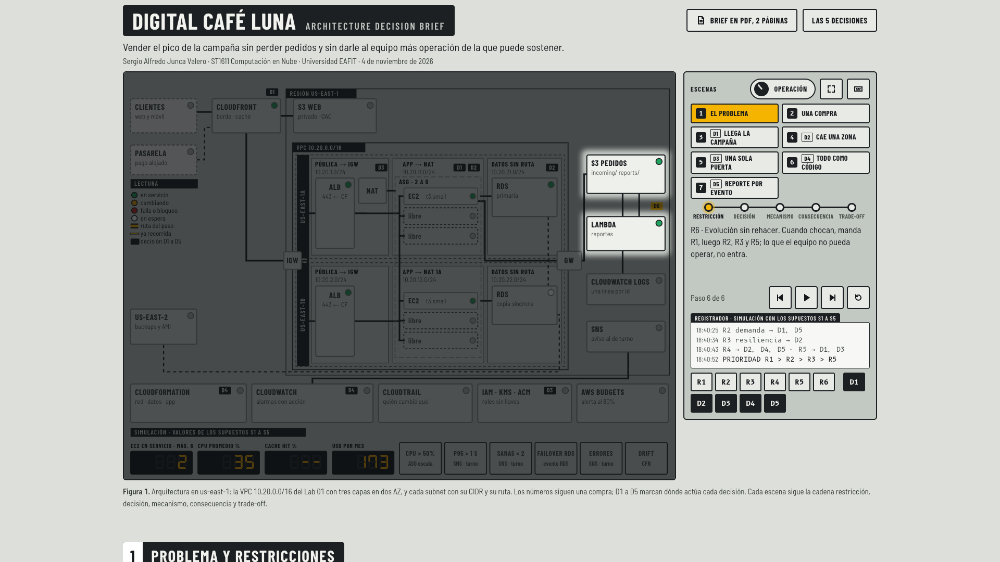

Sexta: crecer sin rehacer. Si chocan, manda pedidos y datos, luego demanda, resiliencia y costo. Lo que el equipo no pueda operar, no entra.

Mis supuestos: 30.000 pedidos al mes, unos 1.000 al día. Campaña de 3 a 5 días con 10 veces el tráfico. Unos 175 dólares al mes, 300 con campaña.

### 07 · Una compra · paso 1 de 5

**Tiempo:** 11 s

**Clic:** `→` · qué se comunica con qué

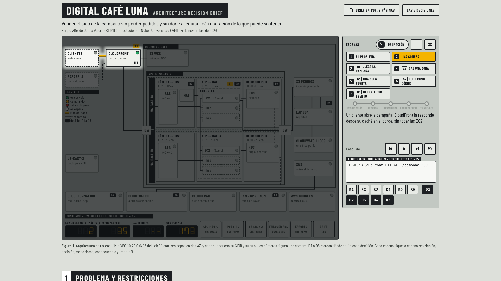

Sigo una compra para mostrar qué se comunica con qué. El cliente abre la campaña y la página sale de la caché de CloudFront, sin tocar los servidores.

### 08 · Una compra · paso 2 de 5

**Tiempo:** 6 s

**Clic:** `→`

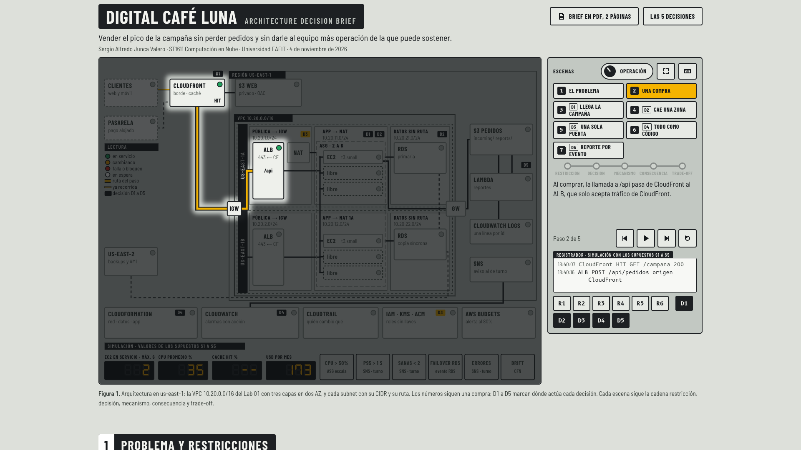

Al comprar, la petición pasa de CloudFront al balanceador, que solo acepta tráfico de CloudFront.

### 09 · Una compra · paso 3 de 5

**Tiempo:** 10 s

**Clic:** `→`

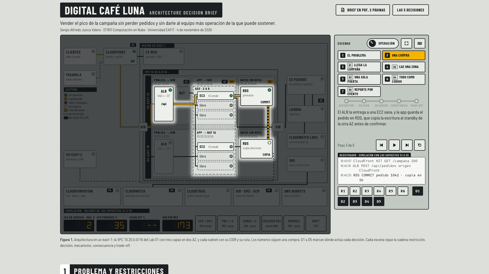

El balanceador la entrega a una instancia sana. La aplicación guarda el pedido en la base, que lo copia a la otra zona antes de confirmar.

### 10 · Una compra · paso 4 de 5

**Tiempo:** 8 s

**Clic:** `→`

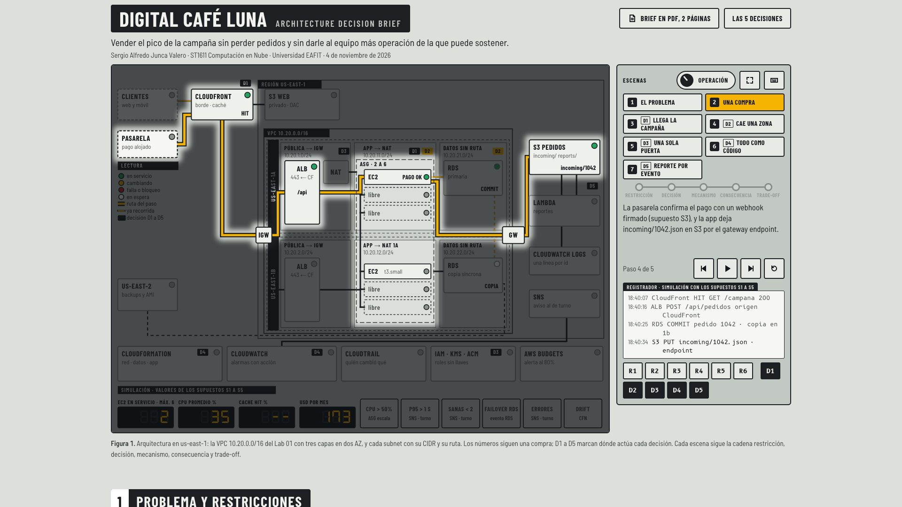

La pasarela confirma el pago con un webhook firmado, y la aplicación deja un archivo del pedido en S3.

### 11 · Una compra · paso 5 de 5

**Tiempo:** 14 s

**Clic:** `→` · dónde vive el estado

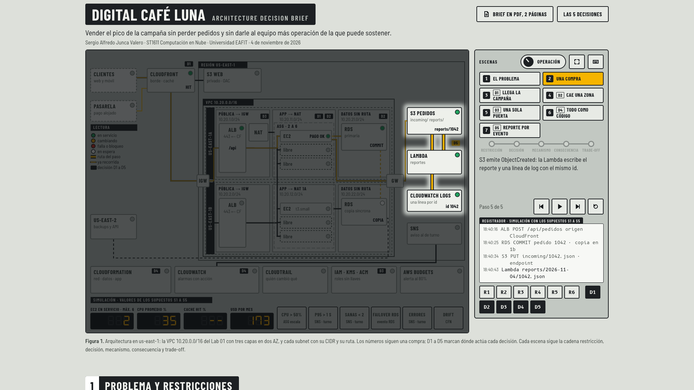

Ese archivo dispara una Lambda que arma el reporte.

El estado no vive en las instancias: sesión en cookie firmada, pedidos en la base, archivos en S3. Por eso puedo perder una instancia sin perder nada.

### 12 · D1 Llega la campaña · paso 1 de 6

**Tiempo:** 9 s

**Clic:** `→` · restricción

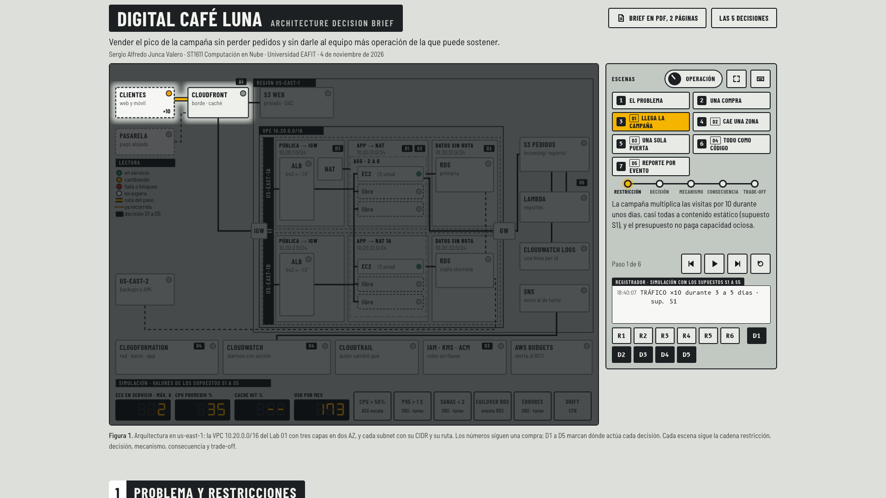

Primera decisión. La restricción: el pico dura pocos días, no sé de qué tamaño será y el presupuesto no paga capacidad ociosa.

### 13 · D1 Llega la campaña · paso 2 de 6

**Tiempo:** 5 s

**Clic:** `→` · decisión

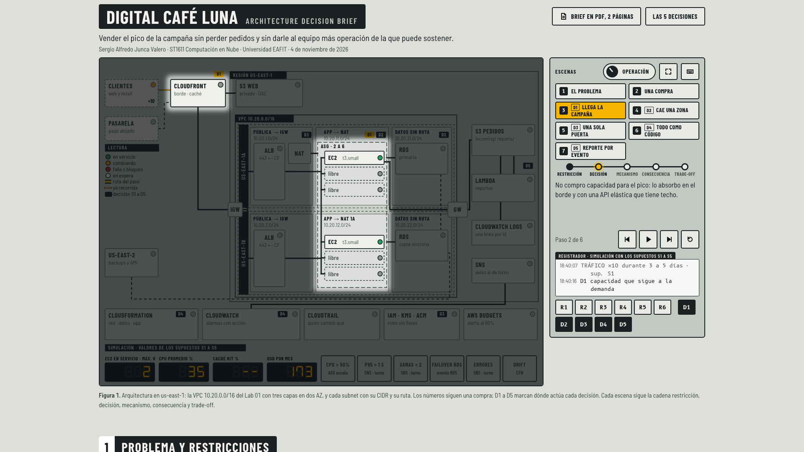

Por eso no compro capacidad para el pico. Lo absorbo en dos niveles.

### 14 · D1 Llega la campaña · paso 3 de 6

**Tiempo:** 11 s

**Clic:** `→` · mecanismo

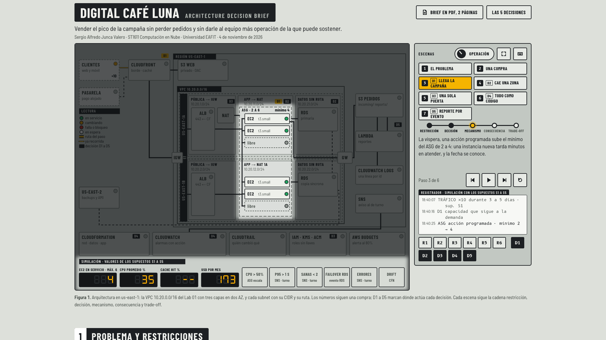

La víspera subo el mínimo de 2 a 4 instancias, porque escalar por métrica toma minutos. En el Lab 06 la alarma necesitó 2 periodos de 5 minutos.

### 15 · D1 Llega la campaña · paso 4 de 6

**Tiempo:** 9 s

**Clic:** `→` · mecanismo

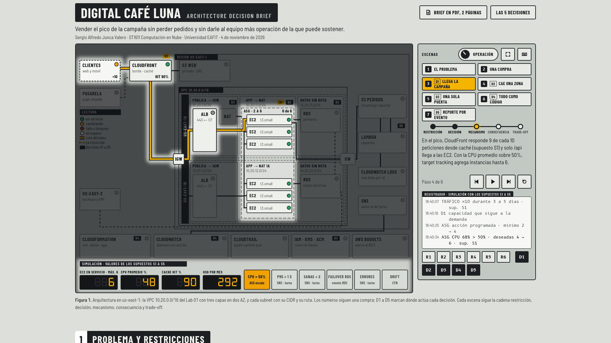

En el pico, CloudFront responde 9 de cada 10 peticiones. Si la CPU promedio pasa de 50%, el grupo llega hasta 6 instancias.

### 16 · D1 Llega la campaña · paso 5 de 6

**Tiempo:** 7 s

**Clic:** `→` · consecuencia

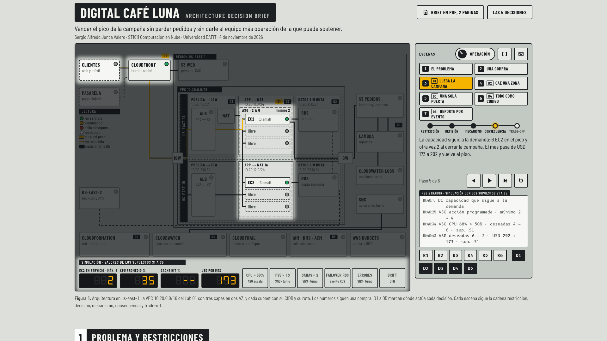

Al cerrar vuelve a 2. El mes pasa de 173 a 292 dólares y regresa al piso.

### 17 · D1 Llega la campaña · paso 6 de 6

**Tiempo:** 23 s

**Clic:** `→` · trade-off, alternativa, riesgo y prueba

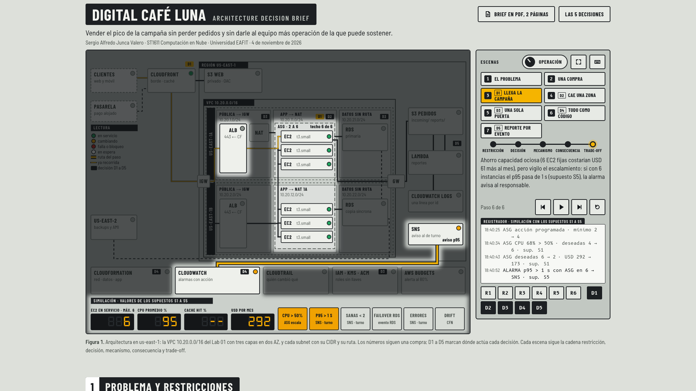

Gano: 6 instancias fijas costarían 61 dólares más al mes. Sacrifico: sobre 6 instancias, la API se degrada. Descarté toda la API en Lambda, porque exige rediseñar antes de la campaña.

Riesgo: un pico mayor que mi supuesto. Lo demuestro con una prueba de carga a 10 veces lo normal: máximo 6 instancias y p95 bajo 1 segundo.

### 18 · D2 Cae una zona · paso 1 de 6

**Tiempo:** 8 s

**Clic:** `→` · restricción

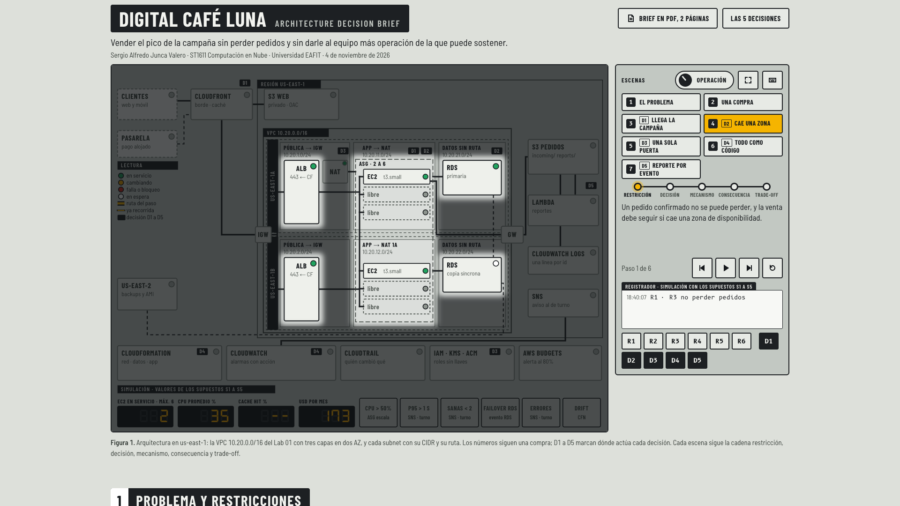

Segunda decisión. La restricción: un pedido confirmado no se puede perder, y la venta sigue aunque caiga una zona.

### 19 · D2 Cae una zona · paso 2 de 6

**Tiempo:** 7 s

**Clic:** `→` · decisión

Por eso todo va en dos zonas, y el estado vive fuera de las instancias, en RDS Multi-AZ.

### 20 · D2 Cae una zona · paso 3 de 6

**Tiempo:** 7 s (12 s con lo opcional)

**Clic:** `→` · mecanismo

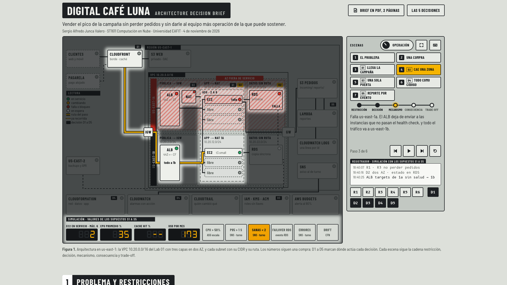

Si cae la zona 1a, el balanceador deja de enviarle tráfico y todo va a la 1b. [Con health check de tipo ELB, el grupo también reemplaza una aplicación colgada.]{.opc}

### 21 · D2 Cae una zona · paso 4 de 6

**Tiempo:** 7 s

**Clic:** `→` · mecanismo

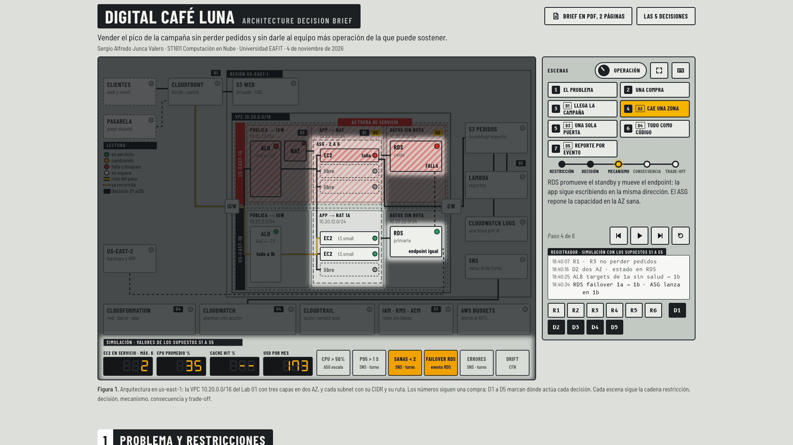

RDS promueve la copia síncrona y mueve el endpoint: la aplicación sigue escribiendo en la misma dirección.

### 22 · D2 Cae una zona · paso 5 de 6

**Tiempo:** 6 s

**Clic:** `→` · consecuencia

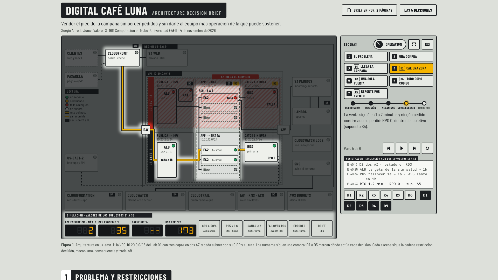

La venta vuelve en 1 a 2 minutos y no pierdo pedidos confirmados: RPO 0.

### 23 · D2 Cae una zona · paso 6 de 6

**Tiempo:** 37 s

**Clic:** `→` · trade-off, alternativa, evidencia, riesgo y prueba

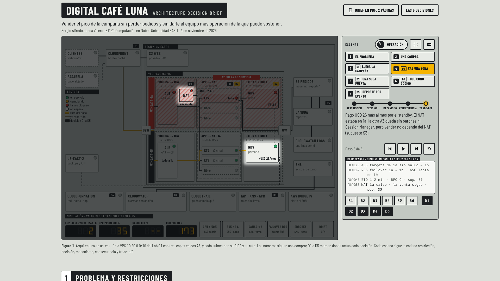

Pago 26 dólares más al mes que con una zona. Sé que se puede ir a varias regiones. No lo hago porque casi duplica el costo fijo y el caso no lo pide. Descarté PostgreSQL en EC2, porque el equipo operaría réplica, backups y parches.

En el Lab 02 el balanceador sacó una instancia en 35 segundos y el reemplazo atendió a los 2 minutos 40.

Riesgo: la base crece en vertical y puede ser el cuello de botella. Lo demuestro con un failover durante la carga: los pedidos coinciden antes y después.

### 24 · D3 Una sola puerta · paso 1 de 6

**Tiempo:** 6 s

**Clic:** `→` · restricción

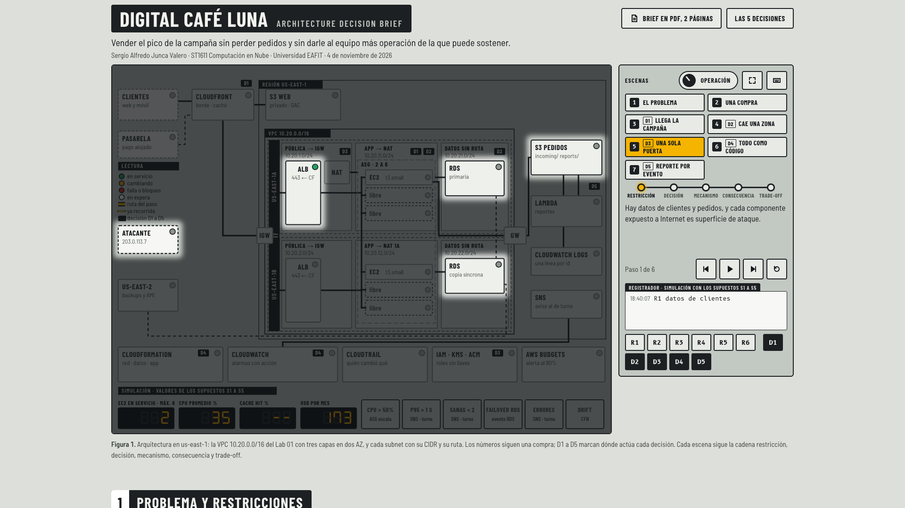

Tercera decisión. La restricción: hay datos de clientes, y lo expuesto a Internet se puede atacar.

### 25 · D3 Una sola puerta · paso 2 de 6

**Tiempo:** 7 s

**Clic:** `→` · decisión

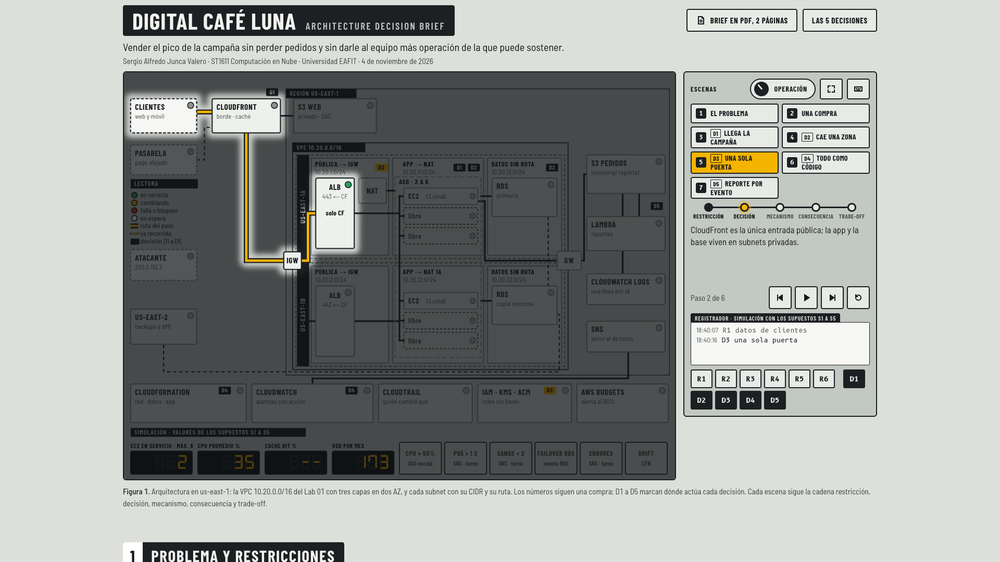

Por eso CloudFront es la única entrada pública, y la aplicación y la base viven en subredes privadas.

### 26 · D3 Una sola puerta · paso 3 de 6

**Tiempo:** 8 s

**Clic:** `→` · mecanismo

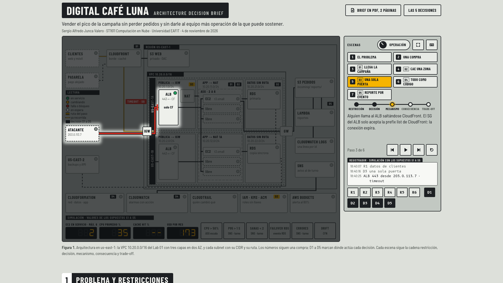

Cada grupo de seguridad acepta solo a la capa anterior. Si alguien llama directo al balanceador, la conexión expira.

### 27 · D3 Una sola puerta · paso 4 de 6

**Tiempo:** 6 s

**Clic:** `→` · mecanismo

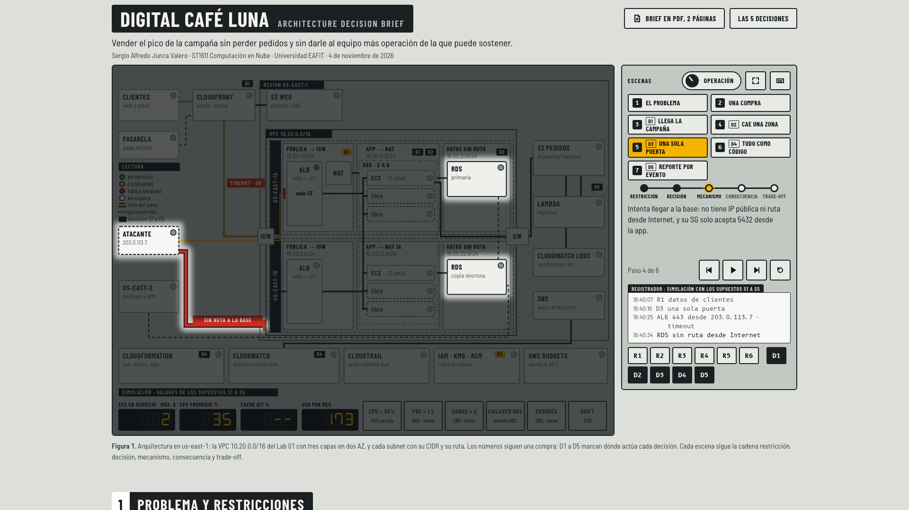

La base no tiene ruta desde Internet y solo acepta el puerto 5432 desde la aplicación.

### 28 · D3 Una sola puerta · paso 5 de 6

**Tiempo:** 10 s

**Clic:** `→` · consecuencia

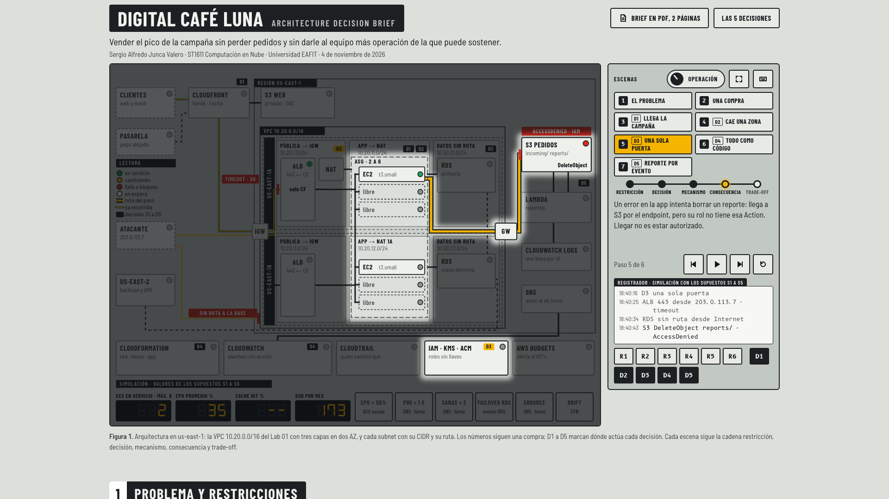

Llegar no es estar autorizado. Si un error de la aplicación intenta borrar un reporte, llega a S3, pero su rol de IAM no lo permite.

### 29 · D3 Una sola puerta · paso 6 de 6

**Tiempo:** 25 s

**Clic:** `→` · trade-off, alternativa, evidencia, riesgo y prueba

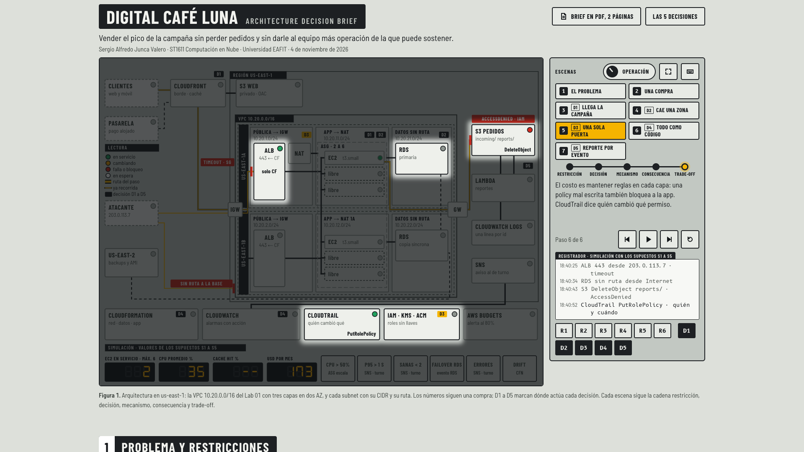

El costo es mantener más reglas. Descarté un NAT por zona: ahorro 37 dólares al mes, y vender no depende del NAT.

En los labs 04 y 05, sin la regla entre grupos hubo timeout, y con el mismo rol leer pasó y escribir dio AccessDenied.

Riesgo: una política mal escrita. Lo demuestro llamando directo al balanceador: timeout, y por CloudFront, 200.

### 30 · D4 Todo como código · paso 1 de 6

**Tiempo:** 9 s

**Clic:** `→` · restricción

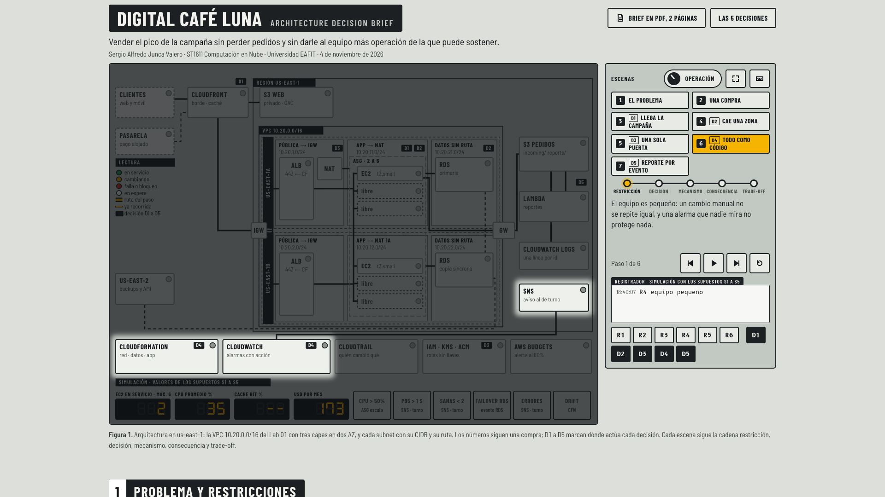

Cuarta decisión. La restricción: con un equipo pequeño, un cambio manual no se repite igual, y una alarma que nadie mira no protege.

### 31 · D4 Todo como código · paso 2 de 6

**Tiempo:** 6 s

**Clic:** `→` · decisión

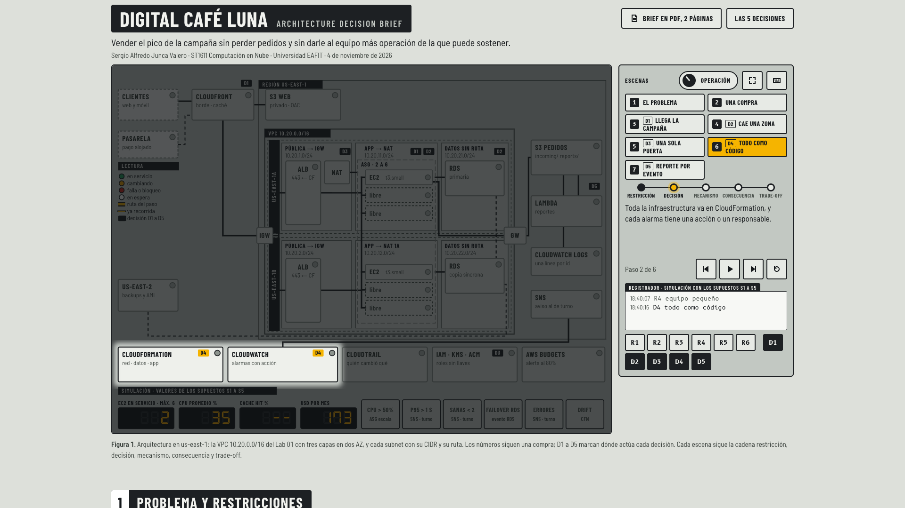

Por eso todo va en CloudFormation, y cada alarma tiene una acción o un responsable.

### 32 · D4 Todo como código · paso 3 de 6

**Tiempo:** 7 s

**Clic:** `→` · mecanismo

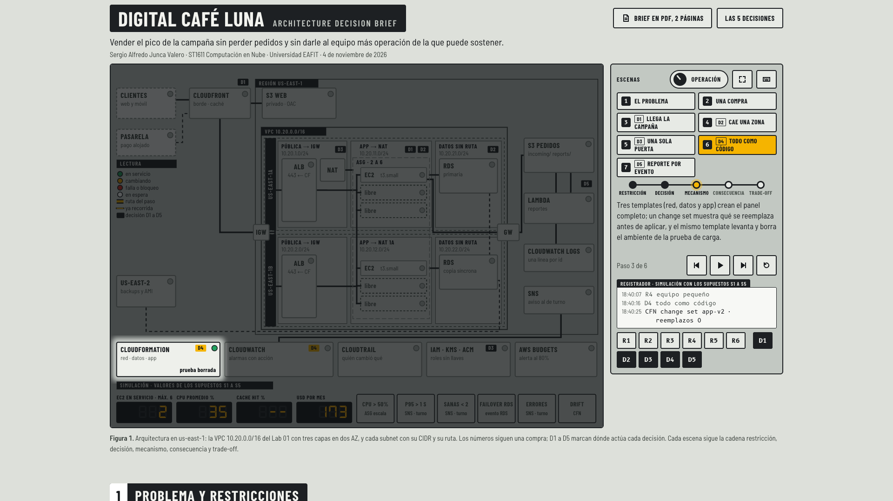

Son 3 plantillas: red, datos y aplicación. El change set muestra qué se reemplaza antes de aplicar.

### 33 · D4 Todo como código · paso 4 de 6

**Tiempo:** 9 s

**Clic:** `→` · mecanismo

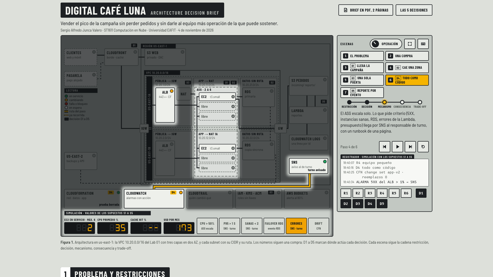

El grupo escala solo. Lo que pide criterio llega por SNS a la persona de turno, con un procedimiento de una página.

### 34 · D4 Todo como código · paso 5 de 6

**Tiempo:** 3 s

**Clic:** `→` · consecuencia

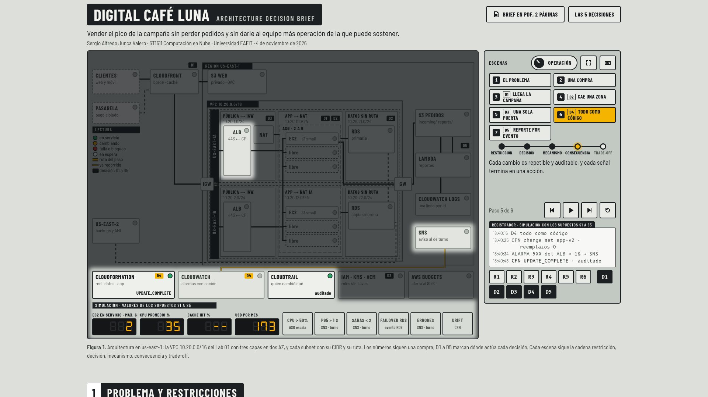

Cada cambio se puede repetir y auditar.

### 35 · D4 Todo como código · paso 6 de 6

**Tiempo:** 22 s

**Clic:** `→` · trade-off, alternativa, evidencia, riesgo y prueba

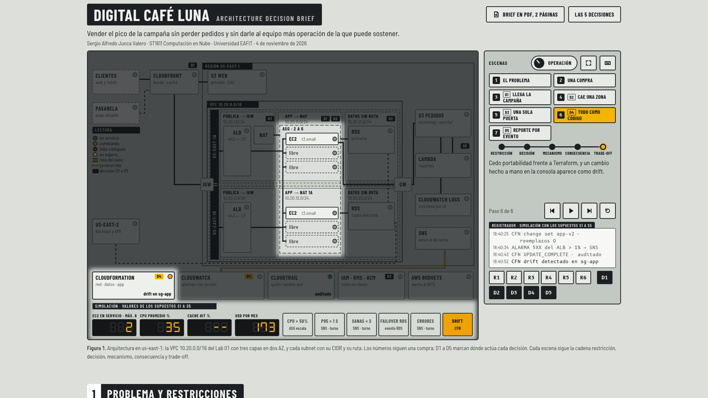

Cedo portabilidad. Descarté Terraform, porque custodiar el archivo de estado no compensa con una sola nube.

En el Lab 06 la alarma llegó a ALARM, pero sin acciones no pasó nada. Por eso ninguna queda sin dueño.

Riesgo: un cambio manual. Lo demuestro cambiando a mano un grupo de seguridad: la detección de drift lo marca.

### 36 · D5 Reporte por evento · paso 1 de 6

**Tiempo:** 9 s

**Clic:** `→` · restricción

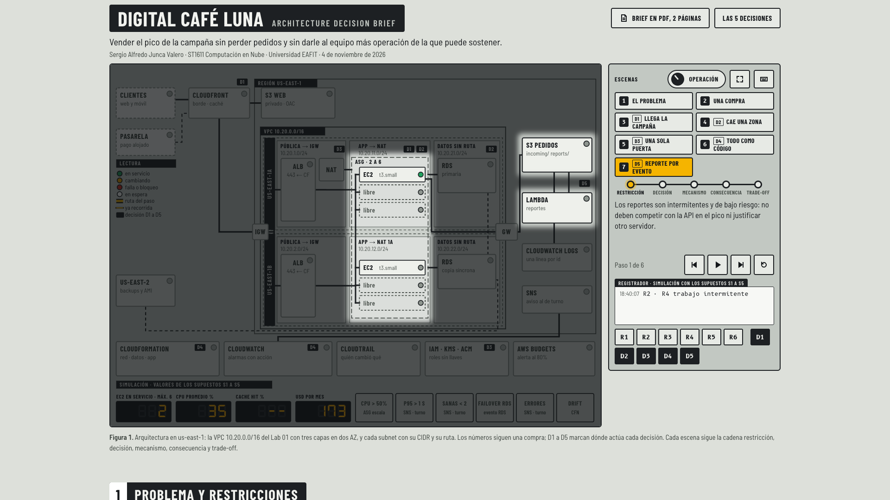

Quinta decisión. La restricción: los reportes son intermitentes y de bajo riesgo, y no deben competir con la API en el pico.

### 37 · D5 Reporte por evento · paso 2 de 6

**Tiempo:** 8 s

**Clic:** `→` · decisión y modelo de ejecución

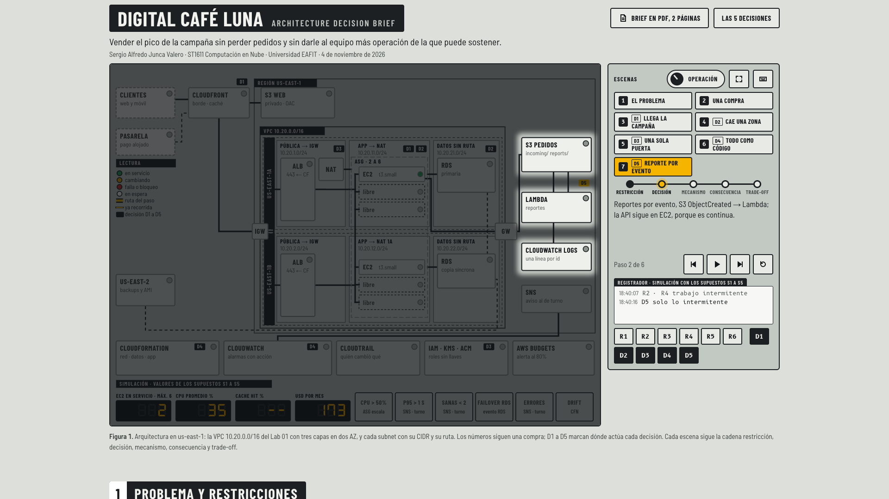

Por eso solo los reportes van por evento a una Lambda. La API es continua y sigue en EC2.

### 38 · D5 Reporte por evento · paso 3 de 6

**Tiempo:** 5 s

**Clic:** `→` · mecanismo

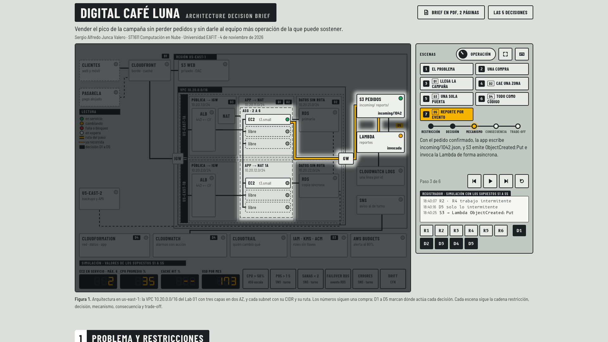

La aplicación escribe un archivo en incoming, y S3 invoca la Lambda.

### 39 · D5 Reporte por evento · paso 4 de 6

**Tiempo:** 12 s

**Clic:** `→` · consecuencia

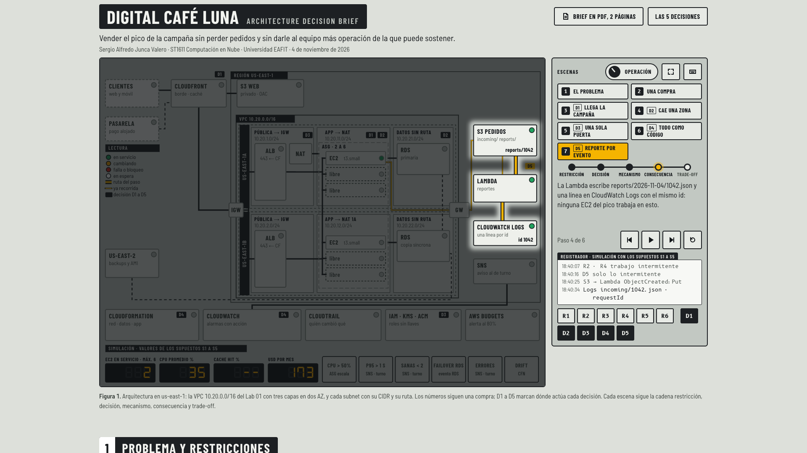

La Lambda escribe el reporte y un log con el mismo número de pedido. Ninguna instancia del pico trabaja en esto, y cuesta menos de 1 dólar al mes.

### 40 · D5 Reporte por evento · paso 5 de 6

**Tiempo:** 13 s

**Clic:** `→` · trade-off

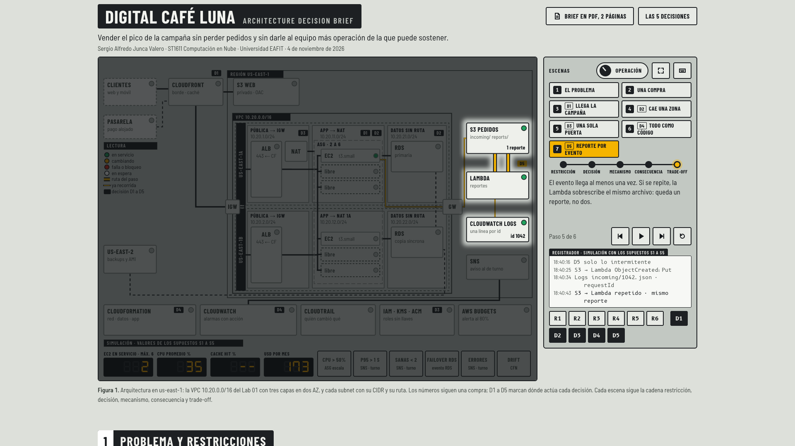

El trade-off: el evento puede llegar dos veces. Como escribo por número de pedido, queda un solo reporte. Descarté un proceso en las EC2, porque compite con la API en el pico.

### 41 · D5 Reporte por evento · paso 6 de 6

**Tiempo:** 17 s

**Clic:** `→` · evidencia, riesgo y prueba

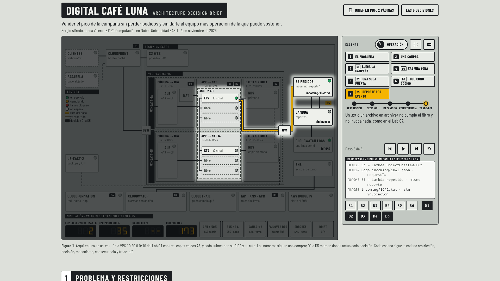

En el Lab 07, un archivo en incoming dio una invocación y un log. Un .txt y archive no invocaron.

Riesgo: un evento que falla tras los reintentos. Avisa una alarma. Lo demuestro subiendo dos veces el mismo pedido: un solo reporte.

### 42 · Costo y evolución · sección 5

**Tiempo:** 38 s (43 s con lo opcional)

**Clic:** `Esc` y bajo con la rueda hasta la sección 5

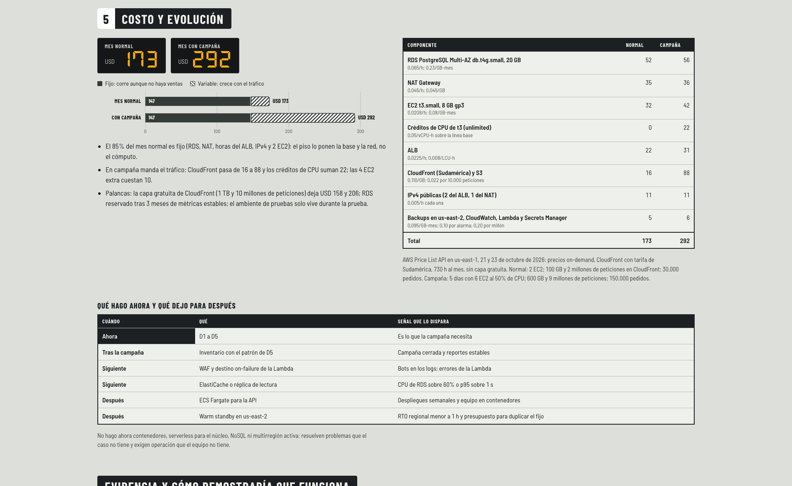

El costo sale de la API de precios de AWS, sin capa gratuita: 173 dólares en un mes normal y 292 con campaña.

El 85% es fijo, 147 dólares. El piso lo ponen la base y la red, no el cómputo. En campaña manda el tráfico: CloudFront pasa de 16 a 88 dólares, y las 4 instancias extra cuestan solo 10.

[La capa gratuita de CloudFront deja el mes en 158 y 206 dólares.]{.opc}

No hago ahora contenedores, varias regiones ni NoSQL: resuelven problemas que el caso no tiene. Cada una tiene su señal. Por ejemplo, réplica de lectura si la CPU de la base pasa de 60%.

### 43 · Evidencia y cierre · sección Evidencia

**Tiempo:** 54 s

**Clic:** bajo con la rueda hasta Evidencia

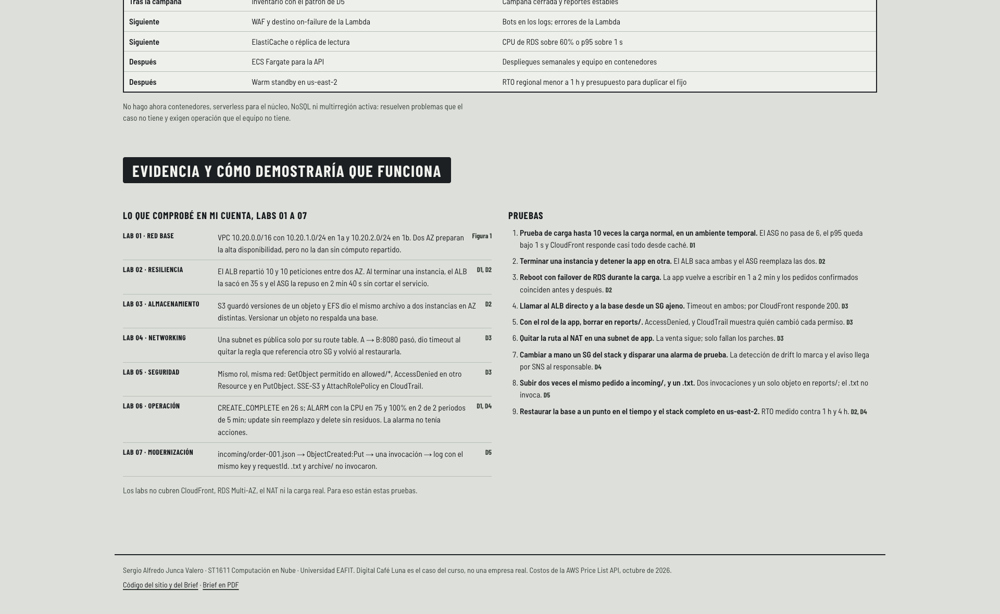

Qué está probado: balanceo, red, permisos, plantillas y eventos, en los labs 01 a 07. CloudFront, Multi-AZ, el NAT y la carga real no los cubren los labs. Por eso dejé 9 pruebas en el Brief, con el resultado esperado.

El valor para Café Luna: vende en el pico sin pagarlo todo el año, no pierde pedidos si cae una zona y un equipo pequeño lo opera.

Escogí cada servicio por la restricción que resuelve, sabiendo qué sacrifico y cuánto cuesta. Gracias, profe.

## Tiempo total

**Sin lo opcional:** 513 s (8:33)

**Con lo opcional:** 526 s (8:46), dentro de los 600 s

**Tiempo asignado:** 600 s (10 minutos)

## Parte 2: las 2 preguntas

Respondo en 30 a 45 segundos y sigo la cadena. Termino con una cifra, un lab o una prueba, y señalo la pieza en el tablero.

### Las 7 preguntas de la lámina del 28 de octubre

El profe dijo que quien las responda sobre su diagrama tiene una base sólida.

**¿Qué se comunica con qué?** El cliente solo habla con CloudFront. CloudFront lee la web del bucket privado y manda la API al balanceador por HTTPS. El balanceador habla con las instancias. Las instancias hablan con la base por el puerto 5432 y con S3 por el gateway endpoint. S3 invoca la Lambda. La pasarela entra por CloudFront con un webhook firmado. La única salida a Internet es el NAT, para parches y Session Manager. *Muestro: `2`, `Espacio` y `→`.*

**¿Quién tiene permiso?** Nadie usa llaves guardadas: cada pieza tiene un rol de IAM mínimo. Las instancias entran a la base con un token de IAM y escriben en incoming, pero no borran reportes. La Lambda lee incoming y escribe en reports. S3 solo puede invocar esa Lambda. CloudTrail registra quién cambió qué. *Respaldo: Lab 05, AccessDenied. Muestro: `5`.*

**¿Dónde vive el estado?** Fuera de las instancias. Pedidos, clientes y carrito en RDS, con copia síncrona en la otra zona y backups de 7 días copiados a us-east-2. La sesión en una cookie firmada. Los archivos en S3. La aplicación en la AMI. Por eso destruyo una instancia sin perder nada. *Respaldo: Lab 02. Muestro: `4`.*

**¿Qué observamos?** Lo que siente el cliente y lo que paga el negocio: p95, errores 5XX, instancias sanas, CPU y conexiones de la base, errores de la Lambda y gasto contra presupuesto. La CPU escala sola. Lo demás avisa por SNS. Sigo el ciclo de la clase: señal, hipótesis, evidencia, acción y aprendizaje. *Muestro: `6` y los indicadores de abajo.*

**¿Qué repetimos?** La infraestructura, con 3 plantillas de CloudFormation que dan el mismo resultado cada vez. Con ellas levanto y borro el ambiente de la prueba de carga, y en un desastre despliego en us-east-2. Cada cambio pasa por un change set. *Respaldo: Lab 06, CREATE_COMPLETE en 26 s, update sin reemplazo y delete sin residuos.*

**¿Qué modelo de ejecución conviene?** Depende de cómo trabaja cada parte. La API es continua y ya corre en Linux: máquinas virtuales con Auto Scaling, sin rediseñar antes de la campaña. La base en un servicio administrado, porque el equipo no puede operar réplicas. Los reportes son intermitentes: Lambda. Lo estático en S3 y CloudFront. Lo administrado me quita operación, no responsabilidad. *Muestro: `7`.*

**¿Qué cuesta, qué riesgo acepto, qué trade-off?** 173 dólares en un mes normal y 292 con campaña, 85% fijo. Acepto un pico mayor que mi supuesto, la base como cuello de botella y una sola región, con 4 horas para volver si cae. Pago a propósito 26 dólares por la base en dos zonas. Decidí no pagar 37 por otro NAT ni 61 por 6 instancias fijas. *Muestro: lámina 42.*

### Las 10 más probables

**1. ¿Lo probaste?** En parte, y lo digo así. Balanceo, reemplazo de instancias, red, permisos, plantillas, alarmas y el evento de S3 a Lambda, en mi cuenta, labs 01 a 07. CloudFront, Multi-AZ, el NAT y la carga real no. Para eso dejé 9 pruebas con su resultado esperado. *Respaldo: lámina 43.*

**2. ¿Y si el pico supera las 6 instancias?** La API se degrada, pero lo estático sigue en CloudFront. La alarma de p95 con el grupo en 6 me avisa. Subir el máximo es un update del stack, si el presupuesto lo permite. El techo es mi límite de costo a propósito. *Respaldo: 61 dólares más al mes por 6 fijas.*

**3. ¿Cómo sabes que 6 instancias alcanzan?** Todavía no lo sé: es un supuesto. Lo valido con la prueba de carga a 10 veces lo normal. Si el p95 pasa de 1 segundo, subo el techo con presupuesto aprobado o guardo más catálogo en caché. *Respaldo: prueba 1.*

**4. ¿Por qué no Kubernetes o contenedores?** No resuelve ninguna restricción del caso y le suma operación a un equipo pequeño. El pico lo absorben CloudFront y el grupo, y supuse un equipo que domina Linux y SQL. Lo consideraría, empezando por ECS Fargate, con despliegues semanales y un equipo que sepa contenedores. *Respaldo: supuesto S4 y tabla de evolución.*

**5. ¿Por qué un balanceador solo no recupera capacidad?** Solo decide a quién manda tráfico: deja de enviarle a la instancia enferma, pero no crea otra. El que repone es el grupo de Auto Scaling. *Respaldo: Lab 02, 35 segundos y 2 minutos 40.*

**6. ¿Por qué un solo NAT si la resiliencia pesa más que el costo?** Porque vender no depende de él. La aplicación viene en la AMI, S3 va por el gateway endpoint y el pago entra como webhook. Si la pasarela exigiera llamadas salientes, pondría uno por zona. *Respaldo: 37 dólares al mes, supuesto S3, prueba 6.*

**7. ¿Por qué RDS y no DynamoDB o PostgreSQL en EC2?** Los pedidos son relacionales, necesitan transacciones y el equipo sabe SQL. En EC2 operaría réplica, backups y parches. DynamoDB obliga a remodelar los datos antes de la campaña. *Respaldo: D2, 52 dólares al mes.*

**8. ¿Qué pasa si cae toda la región?** Restauro backups y plantillas en us-east-2: RTO de 4 horas y RPO de 1 hora. Bajarlo a minutos pide un warm standby, que casi duplica el costo fijo. Lo haría si el negocio pide menos de 1 hora. *Respaldo: tabla de resiliencia, prueba 9.*

**9. ¿Qué hace la Lambda si llega el mismo evento dos veces?** Reescribe el mismo archivo, porque el nombre es el número del pedido. Queda un reporte. Si falla tras los reintentos, la alarma avisa y reproceso desde incoming. El pedido está a salvo en la base. *Respaldo: Lab 07, prueba 8.*

**10. ¿Por qué el 85% es fijo y qué es lo más caro?** Base, NAT, balanceador e IP públicas se cobran por hora, haya ventas o no. Es el precio de no perder pedidos y tener una sola puerta. Lo más caro: la base, 52, y el NAT, 35. En campaña, CloudFront, 88. *Respaldo: tabla de la lámina 42.*

El resto de las preguntas, los números y cada pieza del diagrama están en `../guion.html`.

## Parte 3: si trae una restricción nueva

Es la misma para todos, no exige tecnologías fuera del curso y el Brief no cambia. Respondo de palabra y la marco en el tablero con la tecla `A`.

**La fórmula:** "Mantengo \_\_\_ porque \_\_\_. Cambio \_\_\_ por \_\_\_ porque \_\_\_. Gano \_\_\_ y sacrifico \_\_\_. El riesgo nuevo es \_\_\_, y lo valido con \_\_\_."

**1. El presupuesto se reduce a la mitad, unos 90 dólares al mes.** El costo sube en la prioridad. Mantengo CloudFront, el grupo con techo, la Lambda y CloudFormation. Paso la base a una sola zona, con restauración a un punto, y ahorro 26 dólares. Quito el NAT y ahorro unos 37: los parches llegan con una AMI nueva y un instance refresh, el operador entra por EC2 Instance Connect Endpoint y los logs de la aplicación van a S3 por el gateway endpoint. Con la capa gratuita de CloudFront el mes queda en unos 95 dólares, cerca de la meta. Sacrifico el RPO 0 si cae una zona: la base se restaura en una hora y puedo perder hasta 5 minutos de pedidos. Lo valido con un ensayo de restauración y una alerta de AWS Budgets al 80%. En el tablero marco la base para cambiar y el NAT para quitar.

**2. Los datos personales no pueden salir de Colombia.** Toca los datos, que son lo primero. AWS no tiene región en Colombia, así que separo: los datos personales quedan en el país, en un centro de datos propio o de un proveedor local, y en AWS solo viajan tokens o el id del cliente. La aplicación consulta el dato personal por VPN cuando lo necesita. Es una nube híbrida: gano cumplimiento, pero sumo latencia y un sitio más que operar, y eso choca con el equipo pequeño. Antes confirmaría si lo exige la ley o un contrato, porque la Ley 1581 permite transferir datos a países con un nivel adecuado de protección. Lo valido midiendo la latencia de la VPN en la prueba de carga.

**3. El pico es 10 veces mayor que el supuesto.** Toca la demanda y vuelve la base el cuello de botella. Subo el techo del grupo con presupuesto aprobado, guardo en la caché de CloudFront las consultas de catálogo de la API, que son de solo lectura, con un tiempo de vida corto, agrego ElastiCache o una réplica de lectura y subo la clase de la base la víspera. Ese cambio de clase es un failover de 1 a 2 minutos, así que lo hago antes de la campaña y no durante. Sacrifico costo variable y frescura del catálogo. Lo valido con una prueba de carga al nuevo pico, mirando el p95, la CPU y las conexiones de la base.

**4. Disponibilidad de 99,99% o recuperar la región en minutos.** Toca la resiliencia. Paso de backup y restauración a un warm standby en us-east-2: una réplica de lectura de la base entre regiones, un grupo mínimo y un balanceador allá, y el cambio de origen en CloudFront o en Route 53. La recuperación baja a minutos y la pérdida de datos a segundos, porque esa réplica es asíncrona. A cambio, el costo fijo casi se duplica y hay más piezas que operar. Lo valido con un ensayo de failover regional que mida el RTO y el RPO reales.

**5. El equipo se reduce a una persona.** El límite del equipo se vuelve más duro. Mantengo todo administrado, porque el grupo, el balanceador y el failover de la base ya se recuperan solos. Quito piezas, como el NAT, dejo cada alarma con una acción automática o un procedimiento de una página, y las plantillas documentan la arquitectura. El riesgo es que todo el conocimiento quede en una sola persona y la guardia pese mucho. Lo valido con un simulacro en el que esa persona sigue el procedimiento sola.

**6. Cifrado con llaves propias o auditoría estricta.** Toca los datos. Uso KMS con una llave administrada por el cliente en S3 y en la base, que cuesta 1 dólar al mes por llave. En RDS el cifrado se define al crear la base, así que hago un snapshot, lo copio con la llave nueva y restauro, con una ventana de corte. Sumo los data events de CloudTrail en los buckets con datos de clientes y el registro de sesiones de Session Manager. El riesgo nuevo es perder acceso a la llave, que equivale a perder los datos. Lo valido intentando leer con un rol que no tiene permiso sobre la llave.

**7. La pasarela exige llamadas salientes.** Ahora vender depende de la salida a Internet, así que pongo un NAT por zona, 37 dólares más al mes, para que la caída de una zona no corte los pagos. Es justo el supuesto 3 del Brief. Lo valido quitando la ruta al NAT de una zona: los pagos tienen que seguir por la otra.

**8. El inventario de las tiendas entra ya.** Toca la evolución. Uso el mismo patrón de la quinta decisión: cada tienda sube su archivo de stock a incoming/inventario/, una Lambda actualiza la base y la web lee de ahí. El riesgo es vender algo agotado por el desfase entre la tienda y la web; lo reduzco reservando el stock al confirmar y con una conciliación diaria. Lo valido subiendo dos veces el mismo archivo, para ver que no duplica, y uno con error, para ver que salta la alarma.

**9. Las tiendas tienen Internet satelital o intermitente.** El profe usó este ejemplo en clase. La venta en línea no cambia, porque el cliente compra desde su propia conexión a través de CloudFront. Lo que cambia es lo que sale de las tiendas: el archivo de inventario se sube por lotes cuando hay enlace, con reintentos y subida por partes a S3. Como el proceso por evento ya es idempotente, un archivo repetido no duplica nada. Sacrifico frescura del inventario. Lo valido cortando el enlace de una tienda en una prueba y revisando que, al volver, sincronice sin duplicados.

**10. No depender de servicios propietarios.** Mantengo lo que ya es portable: PostgreSQL, Linux y HTTP. Cambio CloudFormation por Terraform, con el estado en S3 y bloqueo, y los reportes pasan a un proceso en contenedor o en la máquina virtual. Sacrifico operación, porque el equipo administra más piezas. Lo valido levantando todo con Terraform en un ambiente temporal.

**11. Bots o ataque de denegación durante la campaña.** CloudFront ya trae Shield Standard. Agrego AWS WAF en CloudFront con reglas por tasa de peticiones y control de bots, unos 5 dólares al mes más las reglas. El riesgo es bloquear clientes reales por error. Lo valido con tráfico sintético que pase el límite y revisando qué bloqueó.

**12. Un cliente pide que borren sus datos (Ley 1581).** Borro su registro en la base. Los backups lo purgan cuando vencen los 7 días. En S3 los reportes se guardan por número de pedido, y los logs no llevan datos personales. El riesgo es que un dato personal se cuele en un log. Lo valido buscando el id del cliente en logs y buckets después del borrado.

## Cómo me preparo

La ruta de apoyo es <https://sjunka.github.io/digital-cafe-luna/demos/>: cada decisión en 20 segundos, con sus preguntas frecuentes.

**Lunes 2 de noviembre: entender.**

1. Veo cada demo y repito su cadena sin mirar: [D1](https://sjunka.github.io/digital-cafe-luna/demos/#D1), [D2](https://sjunka.github.io/digital-cafe-luna/demos/#D2), [D3](https://sjunka.github.io/digital-cafe-luna/demos/#D3), [D4](https://sjunka.github.io/digital-cafe-luna/demos/#D4), [D5](https://sjunka.github.io/digital-cafe-luna/demos/#D5).
2. Dibujo la arquitectura de memoria siguiendo una compra.
3. Respondo en voz alta las 7 preguntas de la lámina.

**Martes 3 de noviembre: ensayar.**

1. Digo los 10 minutos con el reloj del tablero. Repito hasta quedar bajo 9 minutos 45.
2. Repaso las cifras sin mirar: 173 y 292, 147 fijo, 26, 37, 61, 1 a 2 minutos, 4 horas, 35 segundos y 2 minutos 40.
3. Ensayo 2 restricciones con la tecla `A`: presupuesto a la mitad y pico 10 veces mayor.

**Miércoles 4 de noviembre: repasar.**

1. Hago una pasada completa con el tablero y pido a alguien 2 preguntas al azar.
2. Pruebo cámara y micrófono. Si el sitio no carga, abro `web/dist/index.html` en local.
